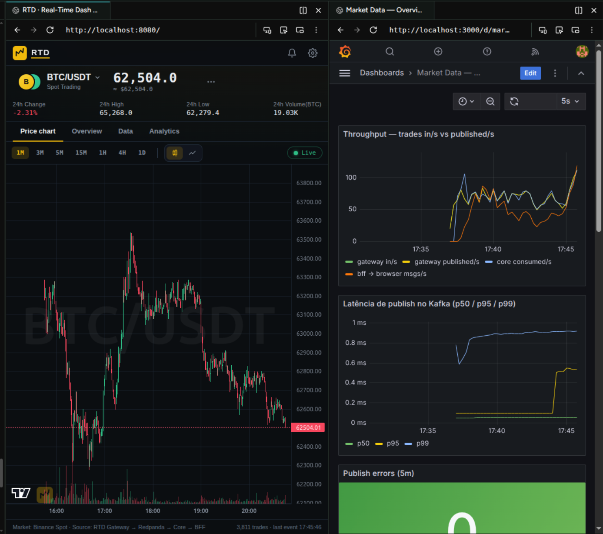

# Real-Time Dash — Market Data em Tempo Real (Binance)



Implementação em andamento do roadmap descrito em
`Arquitetura RPC e Streaming de Dados em Tempo Real (Integração Binance).md`:

- ✅ **Fase 1** — Contrato `proto/market_data.proto` homologado
  (`marketdata.v1`); **Gateway de Aquisição (Camada 1, Go)** com WebSocket
  resiliente + backoff/jitter e parsing JSON → Protobuf; **Serviço Core
  (Camada 3, Java)** com `StreamTicker` (Server-Side Streaming).
- ✅ **Fase 2** — Barramento de eventos (Redpanda, API Kafka) com tópico
  `market.trades` (3 partições, chave = symbol); gateway publica Protobuf
  como binário; core consome via `KafkaTradeSource` com **dedup
  `trade_id` via Redis** (SET NX PX) ou janela deslizante em memória;
  validado ponta a ponta ao vivo (Binance → gateway → Redpanda → core → gRPC).
- ✅ **Fase 3** — BFF em Go (`cmd/bff`): downgrade gRPC → **WebSocket**
  (`/ws?symbol=`), fan-out por símbolo para N browsers, proxies cache para
  `ticker24h`/`klines` da Binance; **UI de trading estilo Binance**
  (`http://localhost:8080`) com seletor de par que troca o gráfico ao vivo;
  observabilidade: Prometheus + Grafana (dashboard provisionado) + Jaeger
  (OTel nos saltos WS→Kafka e gRPC→WS).

## Layout

```
proto/market_data.proto     # contrato único (fonte de verdade)
v1/                         # bindings Go gerados (protoc-gen-go)
cmd/gateway/                # gateway de aquisição (Go)
cmd/coreprobe/              # cliente gRPC de smoke test (Go → Java)
cmd/loadprobe/              # gerador de carga sintética (soak test do caminho Kafka)
cmd/bff/                    # BFF (Go): UI, /ws, proxies, /metrics
  static/                   # SPA (candles + seletor de par, Lightweight Charts vendorizada)
internal/binance/           # cliente WS + backoff/jitter
internal/normalizer/        # JSON Binance → TickerResponse (validação)
internal/publisher/         # sink dos trades (stdout + Kafka/Redpanda)
internal/metrics/           # métricas Prometheus (client_golang) + /metrics
internal/tracing/           # OTel setup (OTLP/HTTP) compartilhado
core/                       # serviço core gRPC (Java 21, Maven)
  src/.../core/source/      # TradeSource: SimulatedTradeSource, KafkaTradeSource
  src/.../core/dedup/       # DedupStore: InMemoryDedupStore, RedisDedupStore
  src/.../core/metrics/     # Micrometer → /metrics :8081
deploy/docker-compose.yml   # Redpanda + Redis + Prometheus + Grafana + Jaeger
deploy/grafana/             # datasource + dashboard "Market Data — Overview"
deploy/prometheus/          # scrape config (gateway :9090, BFF :8080, core :8081)
```

## Fase 2 — Kafka (Redpanda) + dedup Redis

Pré-requisitos: Docker com Compose.

```bash
# 1) infra: Redpanda (API Kafka) + Redis + tópico market.trades (3 partições)
make infra-up

# 2) terminal A: gateway publicando Protobuf no tópico
make gateway-kafka

# 3) terminal B: core consumindo do tópico com dedup Redis
make core-kafka

# 4) terminal C: ver o stream ao vivo (Binance → gateway → Redpanda → core → gRPC)
go run ./cmd/coreprobe --symbol BTCUSDT --count 10
```

Verificar dedup no Redis:

```bash
docker exec rtd-redis redis-cli --scan --pattern 'dedup:trade:*' | wc -l
docker exec rtd-redis redis-cli GET dedup:trade:BTCUSDT:6877905368   # "1"
```

Parar a infra (remove volumes):

```bash
make infra-down
```

Notas de design:

- **Chave da mensagem = `symbol`** (não `trade_id`, divergindo da redação do
  doc): trade_id é único por trade e espalharia trades do mesmo ativo em
  partições arbitrárias; symbol garante que trades do mesmo ativo caem na
  mesma partição, preservando a ordem cronológica — o objetivo declarado no
  próprio documento. trade_id segue como header e como chave de dedup.
- **Dedup**: `SET dedup:trade:{symbol}:{trade_id} 1 NX PX 300000` (atômico).
  Chave existe → duplicado → descarte silencioso. TTL default 5min (flag
  `--dedup-ttl-ms`). Em memória (desenvolvimento): janela deslizante com TTL
  e teto de entradas.
- **Falha do Redis**: consumidor faz *fail-open* — aceita o evento e loga
  warning (1 por 5s) ao invés de congelar os dashboards. Decisão documentada
  no javadoc de `RedisDedupStore`; inverta para fail-closed se preferir.
  Verificado ao vivo: Redis derrubado → warnings chegam e trades continuam
  fluindo; Redis restaurado → warnings param, dedup volta a gravar (TTL
  continua valendo).
- **Backpressure end-to-end** (cliente gRPC lento → HTTP/2 → buffer gRPC →
  fonte): cada assinatura `StreamTicker` tem uma fila bounded
  (1024 trades por default, configurável). Cliente lento e fila cheia →
  o cliente é **desconectado com `RESOURCE_EXHAUSTED`** e a subscription é
  derrubada; o consumidor nunca trava, nunca há descarte silencioso nem
  crescimento ilimitado de memória; clientes rápidos não são afetados.
  Drenagem obedece o HTTP/2 flow control (`isReady()`); quando a janela
  abre, o `onReadyHandler` drena a fila em ordem. Ver `StreamSession` e
  `StreamSessionTest`.
- **Falha do Kafka**: o poll loop trata exceções transitórias como retry
  (log + backoff de 1ms~500ms); rebalances são registrados (log + contador)
  e a entrega continua. Testes com `FakeConsumer` (sem broker) cobrem:
  falhas transitórias consecutivas, rebalance 2 partições → 1 partição,
  close rápido do loop e dedup compartilhada entre consumers.
- **Soak test**: `go run ./cmd/loadprobe --symbol LOADTEST --rate 400 --duration 12s`
  produziu **4800 mensagens a 400 msg/s, 0 falhas**; o core consumiu e
  deduplicou todas (4800 chaves `dedup:trade:LOADTEST:*` no Redis), lag do
  grupo ≈ 0s após drenar, e `coreprobe` recebeu 100 trades ao vivo durante a
  produção. Catch-up de backlog: **4371 msgs em 8s** (partição 2).

  produção. Catch-up de backlog: **4371 msgs em 8s** (partição 2).

## Fase 3 — BFF, UI estilo Binance e Observabilidade

Pré-requisitos: Docker com Compose + infra de pé (`make infra-up`).

```bash
make core-kafka     # core gRPC consumindo market.trades (porta 50051) + /metrics :8081
make gateway-kafka  # gateway publicando no Redpanda                + /metrics :9090
make bff            # BFF: UI + /ws + proxies                        + /metrics :8080

# depois abra http://localhost:8080
```

Serviços e portas:

| Serviço | URL | O que é |
| :--- | :--- | :--- |
| **UI (SPA embutida no BFF)** | http://localhost:8080 | Dashboard estilo Binance: candles + volume, seletor de par, stats 24h |
| BFF `/api/symbols` | http://localhost:8080/api/symbols | pares aceitos pela UI e pelo `/ws` |
| BFF `/api/klines` | `…?symbol=BTCUSDT&interval=1m&limit=300` | proxy cache (5s) do `/api/v3/klines` da Binance |
| BFF `/api/ticker24h` | `…?symbol=BTCUSDT` | proxy cache (5s) do `/api/v3/ticker/24hr` |
| BFF `/ws` | `ws://localhost:8080/ws?symbol=BTCUSDT` | trades via WebSocket (downgrade gRPC → WS) |
| Prometheus | http://localhost:9093 | scrapes: gateway :9090, BFF :8080, core :8081 |
| Grafana | http://localhost:3000 | dashboard **Market Data — Overview** (admin/admin, só dev local!) |
| Jaeger | http://localhost:16686 | tracing OTLP do salto de protocolo (gateway → Kafka → core → BFF) |
| Core `/metrics` | http://localhost:8081/metrics | trades consumidos/duplicados/despachados, streams ativos, disconnects |

**UI** (baseada na tela de trading da Binance enviada como referência):

- Seletor de par (BTC/USDT · ETH/USDT · BNB/USDT · SOL/USDT · XRP/USDT ·
  DOGE/USDT, filtrável com `/` ou clicando): **trocar de par recarrega
  candles, stats, watermark e assinatura WS**.
- Candlesticks + volume embaixo (Lightweight Charts vendorizada em
  `cmd/bff/static/vendor/`, Apache-2.0), 300 candles iniciais (`/api/klines`)
  com atualização ao vivo a cada trade.
- Header: preço com flash verde/vermelho, 24h Change, 24h High/Low, 24h
  Volume — dados do `/api/ticker24h` (refresh 5s).
- Conexão resiliente: badge Live/Reconnecting, backoff e **self-heal**
  (refetch de klines após reconectar — fecha o gap); seleção persistida em
  `localStorage`.
- Toggle candles ⇄ linha; intervalos 1M…1D; contador de trades + horário do
  último evento na statusbar.

Notas de design:

- **BFF em Go** (o doc previa "Node.js (NestJS) / Go"): reutiliza os stubs
  gRPC Go e o pipeline de métricas. UI estática embutida com `go:embed` —
  sem build step, sem CDN.
- **Multiplexação**: 1 upstream `StreamTicker` por símbolo, fan-out para N
  browsers; quando o último cliente sai, o stream upstream é cancelado.
- **Consumidor lento no BFF**: fila de 256 mensagens por cliente; estourou →
  WebSocket desconectado (a UI reconecta e refaz fetch — sem perda silenciosa).
- **Observabilidade end-to-end**: métricas nos três destinos do Prometheus
  (throughput, latência de publish com histogramas p50/p95/p99, dedup
  dispatched/duplicates, disconnects, streams ativos) e spans OTel no
  gateway (`gateway.publish`) e no BFF (`bff.upstream.recv`).
- **Circuit Breaker**: ainda não aplicável — não há chamada síncrona REST no
  caminho de dados; o proxy da Binance já tem timeout de 4s + cache com TTL.
- **Verificado ao vivo** (2026-11-18): proxies com dados reais; UI trocando
  BTC→ETH→BTC; badge Live; Prometheus com os 3 targets `up`; Grafana com o
  dashboard provisionado; Jaeger com `gateway.publish` (ex:
  `event_age_ms=156`) e `bff.upstream.recv`.
- Pendências honestas: SSE não implementado (doc previa WS **ou** SSE — WS
  escolhido); sem autenticação na UI/BFF (dev local); tabs Overview/Data/
  Analytics decorativas; `admin/admin` do Grafana é só para dev; CI não
  executa trading real.

## Pré-requisitos

- Go ≥ 1.23, Java 21, Maven ≥ 3.8, `protoc` ≥ 29 (apenas para regenerar os bindings Go)
- Rede com acesso a `stream.binance.com`
- Fase 2: Docker + Compose (Redpanda + Redis locais)

## Regenerar bindings

```bash
# Go (protoc + protoc-gen-go + protoc-gen-go-grpc)
protoc -I=proto --go_out=. --go_opt=module=github.com/financial/marketdata \
                --go-grpc_out=. --go-grpc_opt=module=github.com/financial/marketdata \
                proto/market_data.proto

# Java (feito automaticamente pelo Maven via protobuf-maven-plugin; proto vai de ../proto)
cd core && mvn compile
```

## Executar o Gateway (Go)

```bash
go run ./cmd/gateway --symbols BTCUSDT,ETHUSDT --metrics-addr :9090
# trades normalizados → linhas JSON no stdout
# métricas → curl localhost:9090/metrics   (/healthz também disponível)
```

## Executar o Core (Java)

```bash
cd core && mvn -q package
java -jar target/core-1.0.0-SNAPSHOT.jar --port 50051   # default: 50051
```

## Smoke test ponta a ponta (Go → Java via gRPC)

```bash
go run ./cmd/coreprobe --symbol BTCUSDT --count 10
go run ./cmd/coreprobe --symbol ETHUSDT --aggregation 1000 --count 5   # janelas VWAP de 1s
```

## Testes

```bash
make test        # tudo
make test-go     # go test -race ./...
make test-java   # (cd core && mvn test)
```

Cobertura automatizada atual (Fase 1 + Fase 2):

| Componente | Testes | O que cobre |
| :--- | :--- | :--- |
| `internal/binance` | `backoff_test.go`, `client_test.go` | Crescimento/teto/jitter/reset do backoff; WS fake via `httptest`: ingestão ponta a ponta, **reconexão após queda abrupta**, frames malformados ignorados, cancelamento via context (`-race` limpo) |
| `internal/normalizer` | `normalizer_test.go` | Envelope `stream+data`, frame cru, validação de preço/qty/trade_id, variantes de `b`/`a` (spot ausente, futures string/número) |
| | `regression_test.go` | Regressão: `b:null`/`a:null` não podem derrubar o frame; `"data":null` no envelope é rejeitado; frame `null` nunca vira trade |
| `internal/publisher` | `publisher_test.go` | Linha JSON válida com todos os campos do contrato |
| | `kafka_test.go` | Chave = symbol, headers `trade_id`/`event_time`, round-trip protobuf, validação de args (sem broker) |
| `internal/metrics` | `metrics_test.go` | Formato Prometheus, `/healthz`, contadores |
| | `regression_test.go` | Regressão: métricas `*_total` expostas com `# TYPE ... counter` (eram `gauge`) |
| `core` (Java) | `StreamTickerTest` | Streaming via gRPC in-process, símbolo vazio/intervalo inválido → `INVALID_ARGUMENT`, janelas VWAP |
| | `SimulatedTradeSourceTest` | Emissão periódica, `trade_id` monotônico, isolamento por símbolo, unsubscribe/close param a emissão |
| | `TradeAggregatorTest` | VWAP exato da janela, janela vazia não emite, janelas separadas geram buckets separados |
| | `RegressionTest` | Regressão: mensagens top-level em `com.financial.marketdata.v1` (falta de `java_multiple_files` quebrou todo o compile); classe externa `MarketData` sem mensagens aninhadas |
| | `KafkaTradeSourceTest` | `handleRecord` sem broker: desserialização protobuf, dedup (1ª aceita/2ª descartada), `trade_id` igual em símbolos distintos **não** é duplicata, payload inválido descartado, fallback de symbol pela payload quando key nula |
| | `KafkaTradeSourceFailureTest` | `FakeConsumer` sem broker: **falhas transitórias consecutivas no poll** (TimeoutException/NotLeaderOrFollower) mantêm o loop vivo e entregam; **rebalance** 2→1 partições mantém a entrega; close rápido do loop; **dedup compartilhada entre consumers** |
| | `InMemoryDedupStoreTest` | `markProcessed` idempotente, TTL expira, teto de entradas (FIFO determinístico por sequência), escopo por símbolo |
| | `RedisDedupStoreTest` | Contra Redis real (`SET NX PX` + TTL). **Gated por env** `REDIS_ADDR` (ex: `REDIS_ADDR=localhost:6379 make test-java`); sem a env, os testes são pulados — CI não sobe Redis |
| | `StreamSessionTest` | Fila bounded por cliente: lento e cheio → `RESOURCE_EXHAUSTED` + teardown; ready drena em ordem; flip de `isReady` dispara o drain via handler; enqueue após disconnect é ignorado |

Total Java: **36 testes**. Resiliência validada ao vivo (ver seção Fase 2):
Redis derrubado → fail-open + recovery; Redpanda derrubado durante o publish
→ produção bloqueia no ack (sem perda) e retoma no restart; soak de 4800
mensagens @400/s com lag ≈ 0 e catch-up de 4371 msgs em 8s.

Ainda não cobertos: cliente lento **real** sobre gRPC/HTTP-2 (o disconnect
por fila cheia é coberto deterministicamente por `StreamSessionTest`, não por
e2e); falhas de Kafka reais de broker (kill do líder, rebalance por
membership real — o `FakeConsumer` simula as classes de exceção, não o
protocolo de grupo de verdade); teste de carga além de 400 msg/s.

## CI/CD

Três camadas, todas rodando os **mesmos testes localmente e no GitHub**:

| Camada | Onde roda | O que faz |
| :--- | :--- | :--- |
| `make ci` | local | `go vet` + `go build` + `go test -race` + `mvn -B clean verify` — idêntico ao pipeline |
| git hook `pre-push` | local (instalado) | roda `make ci` antes de cada `git push`; instale/remova com `make install-hooks` / `make uninstall-hooks`; pule com `git push --no-verify` |
| `.github/workflows/ci.yml` | GitHub (push/PR em `main`) | 3 jobs: `go` (vet/build/test -race), `java` (test + package shade), `contract` (regenera bindings Go do `.proto` e falha se `v1/` divergir) |

Cada job da CI espelha um alvo do Makefile — se a CI falhar, rode `make ci`
localmente, corrija e faça push de novo (o hook já teria barrado antes).

Para rodar o workflow do GitHub Actions localmente via [`act`](https://github.com/nektos/act)
(requer Docker):

```bash
act -j go       # job Go
act -j contract # drift check do contrato
```

Observação: o job `contract` usa `protoc` 29.1 e plugins pinados
(`protoc-gen-go` v1.36.5, `protoc-gen-go-grpc` v1.5.1); se você regenerar
`v1/` com versões diferentes, alinhe os pins em `.github/workflows/ci.yml`.

## Decisões e notas

- **`event_time`** mapeia para o campo `E` (event time) da exchange.
- O stream `@trade` de **spot** não expõe `b`/`a` (buyer/seller order id);
  eles vêm apenas em futures e são lidos tolerando número **ou** string,
  com default `0`.
- `aggregation_interval_ms > 0` agrega trades em janelas fixas de VWAP
  (ver `TradeAggregator`); sem trades na janela, nada é emitido.
- Backoff do gateway: base 500ms, fator 2.0, teto 30s, *equal jitter*;
  resetado após conexão bem-sucedida.
- A Fase 2 (Kafka + idempotency/`trade_id` via Redis) e a Fase 3
  (BFF/WebSocket, observabilidade Prometheus/Grafana/OTel) ainda não
  foram iniciadas.
